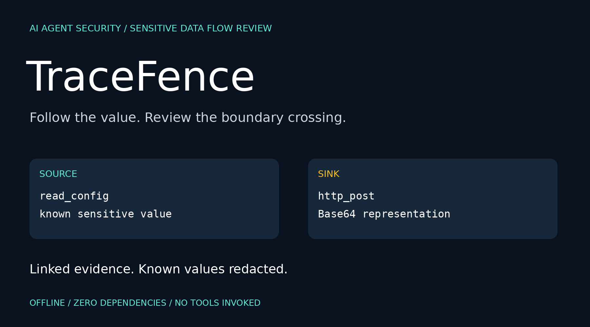
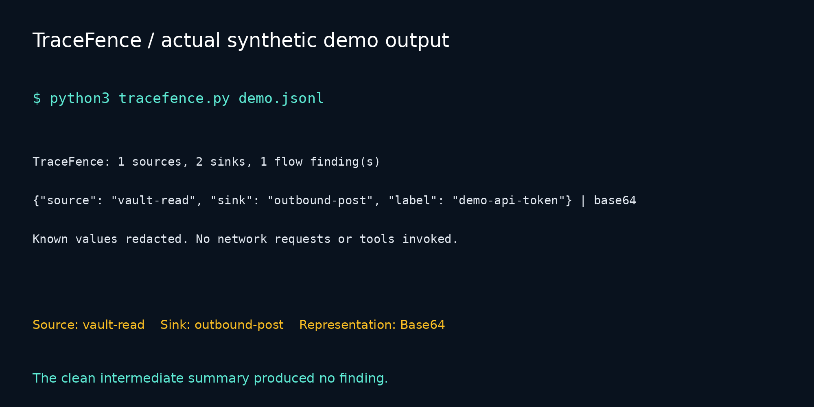

# TraceFence



  

**Show where sensitive data crossed your agent's tool boundary—even when its representation changed.**

TraceFence reviews explicitly instrumented AI-agent traces. It links known sensitive values in a source event to later outbound sink payloads and destinations. It recognizes exact plaintext, URL/form encoding, standard and URL-safe Base64 (including unpadded variants), and lowercase/uppercase hexadecimal representations.

A finding includes source ID, sink ID, tool names, label, JSON field location and matched representation. Known values are scrubbed from report metadata. No network requests, model calls or tool invocations are made.

## The problem this prototype addresses

When reviewing a tool-using agent, a final answer may not show what the agent passed to another tool. TraceFence makes a narrowly defined data flow review reproducible: **a known value was registered at event A and a supported representation appeared in a later sink B**.

It is a developer debugging and review utility. It does not determine malicious intent, prove prompt injection, discover unknown secrets or establish whether a transfer was authorized. This project makes no claim to unprecedented invention, universal detection, production readiness or commercial valuation.

## Quick start

Requires Python 3.10+ and no external dependencies. Download or clone the repository, then open its directory:

```bash
python3 tracefence.py demo.jsonl
python3 tracefence.py demo.jsonl --json
python3 tracefence.py demo.jsonl --html report.html
python3 tracefence.py clean.jsonl
python3 guarded_demo.py
python3 -m unittest discover -v
```

On Windows, use `py -3` if `python3` is unavailable. Open the generated HTML in a browser. A pre-generated synthetic [demo report](demo-report.html) is included; download it to view as HTML.

Demo output:

```text
TraceFence: 1 sources, 2 sinks, 1 flow finding(s)
{"source": "vault-read", "sink": "outbound-post", "label": "demo-api-token"} | base64
Known values redacted. No network requests or tools invoked.
```

The intermediate summary in this demo contains no registered secret and produces no finding. The later outbound request contains a Base64 representation and is flagged.

## Trace format

UTF-8 JSONL, one object per line. Record events in execution order. IDs are globally unique. Both kinds accept exactly the documented fields; blank lines are ignored.

Register a known sensitive value when the application exposes it to the agent:

```json
{"kind":"source","id":"config-read","tool":"read_config","secrets":[{"label":"demo-token","value":"DEMO-ONLY-credential/7f2a+9c="}]}
```

Record a proposed or completed outbound operation as a sink:

```json
{"kind":"sink","id":"request-1","tool":"http_post","destination":"https://collector.example/submit","payload":{"body":"ordinary summary"}}
```

| Field | Meaning |
| --- | --- |
| `kind` | `source` or `sink` |
| `id` | Unique event identifier, at most 200 characters |
| `tool` | Application-supplied tool name, at most 200 characters |
| `secrets` | Nonempty source array of `{label,value}` entries; labels unique within source |
| `destination` | Sink destination string, inspected for registered values; not copied to report |
| `payload` | Any JSON value; nested string values, keys and numeric values are inspected |

Your instrumentation identifies sources and sinks. The tool does not infer network access from a tool name, import native provider traces, access credentials or connect to an MCP server. A local destination can be a sink if the application labels it that way.

## How matching works

1. Register source values and deterministic supported representations.
2. Inspect each later sink's destination and payload leaves.
3. Report one finding per source-value/sink pair, with matched fields.
4. Scrub registered patterns from report metadata, including input-controlled labels and field paths.

Matching uses exact case-sensitive substring search. Equivalent representations are deduplicated; the first matching representation per field is reported. For example, if plain and URL forms are identical, the result is labeled `plain`. Multiple sources of the same value can produce multiple findings; source attribution is temporal evidence, not causal proof.

## Integrate before a tool executes

`guarded_demo.py` demonstrates a local application checking a proposed sink via `audit()` before doing anything with it. The demo application chooses to block when a finding appears. It uses a synthetic token and makes no network request.

For a real adapter, register sensitive tool outputs explicitly, construct a proposed sink from the actual destination and arguments, call `audit(enumerate(events,1))`, and apply your authorization policy before executing the operation. The returned dictionary is redacted. The scanner itself is not a sandbox, hook, proxy or enforcement engine.

## CI and exit codes

```bash
python3 tracefence.py demo.jsonl --fail-on-findings --json > report.json
```

| Exit | Meaning |
| --- | --- |
| 0 | Valid trace; or findings exist without `--fail-on-findings` |
| 1 | At least one finding and `--fail-on-findings` enabled |
| 2 | Input, schema, size, nesting, or report-write error |

Errors intentionally avoid input excerpts and detailed data-derived diagnostics. JSON output uses ASCII escapes; the HTML report escapes markup, contains no JavaScript or external assets and applies a restrictive content security policy.

## Handling sensitive traces

Raw source events contain the values you register. Keep real traces local and access-controlled; do not commit them. The included examples use synthetic values only. Reports remove known registered representations but are not general-purpose anonymizers: tool names, IDs and other unregistered metadata may still be sensitive. Review before sharing. Existing output files are overwritten when `--html` is used; the trace input cannot be the same path as the HTML output.

## Limits and interpretation

- Default minimum value length: 12 characters; configurable with `--min-length` from 8 to 8192.
- Maximum value length: 8192 characters; maximum 500 source-value records.
- Maximum JSONL line: 2,000,000 bytes; payload nesting limited to 32 levels.
- A secret must appear in a source before a sink to contribute a finding.
- Whole-value encodings only. No encryption, hashing, compression, split-token reconstruction, chunk stitching, paraphrase, double encoding, percent-escape case normalization or arbitrary transform decoding.
- Substring matches can be incidental, and legitimate authorized transfers are still reported. Findings require review; absence of findings is not proof of safety.
- Source logs and event ordering are trusted inputs, not independently verified facts. No cryptographic provenance is provided.
- Runtime cost grows with registered patterns and sink payload size. Findings and source patterns are retained in memory; this is not a high-volume production pipeline.

## Validation and launch

Fourteen tests cover supported encodings, temporal order, clean traffic, nested fields, destination leaks, key leaks, metadata redaction, HTML escaping, duplicate IDs, short values and unpadded Base64. CLI exit behavior is also exercised during development.



Launch drafts: [POST.md](POST.md). Suggested GitHub topics: `ai-security`, `agent-security`, `data-leakage`, `dlp`, `blue-team`, `python`, `security-tools`, `llm-security`.

Search phrases: AI agent data leakage tracing, encoded secret leakage, agent tool boundary review, redacted agent trace audit.
